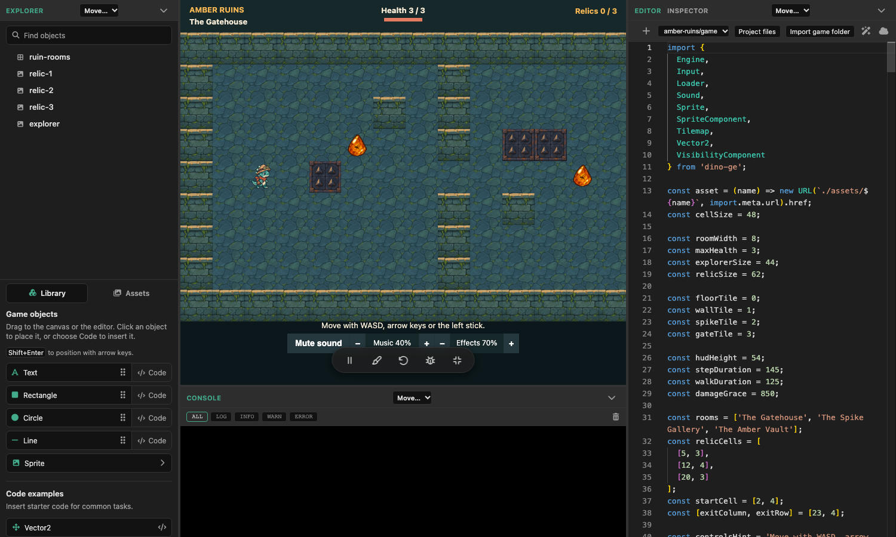
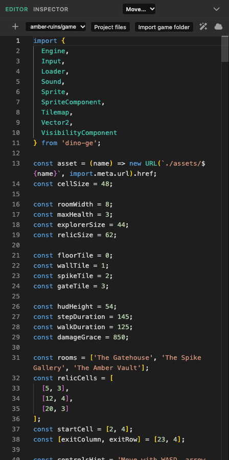
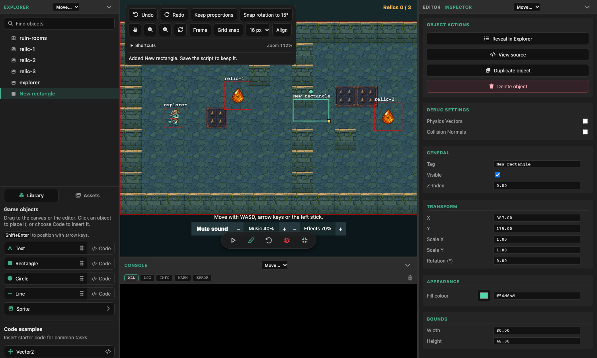
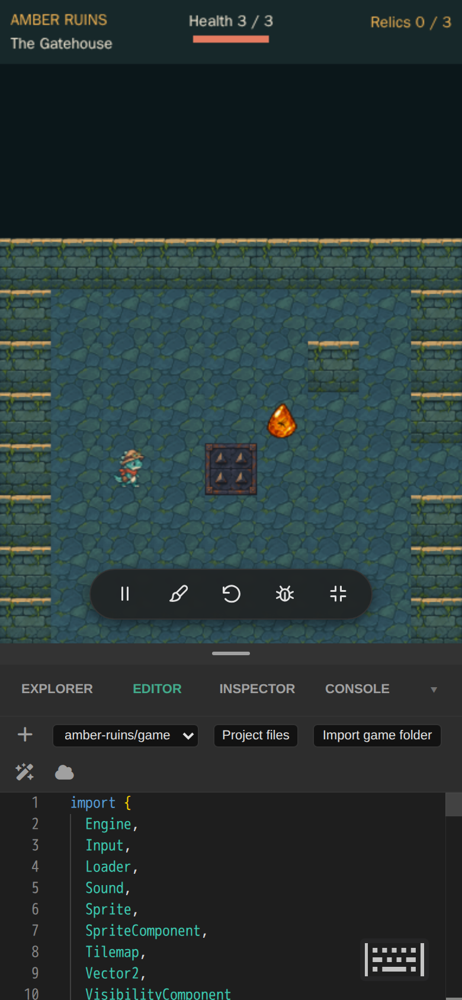

# dino-ge-playground

Interactive, live-editing playground and inspector for the [dino-ge](https://www.npmjs.com/package/dino-ge) game engine.



**Beta preview.** APIs and workflows may change during the beta.

## Installation

Use Node.js 26.13.0 LTS or a patched release on the supported Node.js 24 LTS line
starting at 24.22.1.

```bash
npm install -g dino-ge-playground@beta
```

## Usage

Run the playground in any directory where you'd like to develop game scripts:

```bash
dino-ge-playground
```

Once running, access the editor and inspector at `http://localhost:3000`.

### Features

- **Monaco Code Editor:** Modify your game logic in real-time with an integrated Monaco editor (the engine behind VS Code).
  
- **Property Inspector:** Toggle the UI to inspect and adjust game object properties in real-time.
  
- **Debug Mode:** Visualize collision boxes, velocity vectors, and engine state.
- **Hot Refresh:** Quickly apply changes to your code (`Ctrl + Enter` or click the refresh icon).
- **Play/Pause Controls:** Pause the game and engine audio, then resume from the same point.
- **Auto-Formatting:** Integrated Prettier support for clean, consistent code.

### Mobile workspace

On narrow screens, Explorer, Editor, Inspector and Console share a drawer over the bottom of the game. Drag the handle to change how much of the game the drawer covers. The game keeps its full window size. In the Library, drag an object's grip up to the exposed canvas to place it.



### Script Storage

The playground automatically creates and manages a `scripts/` directory in the folder where the command is executed. All your JavaScript game scripts are stored here.

An empty workspace starts with an editable copy of **Amber Ruins**. An
existing workspace opens its scripts as usual.

To bring in another game, choose **Import game folder** in the editor, select
the game's folder, then pick its JavaScript entry file and choose
**Import and run**. Playground copies the folder into `scripts/` and
preserves relative modules and assets. It accepts browser-native JavaScript
modules that can import `dino-ge`, with up to 512 files and 16 MiB per game.
If your game uses a bundler, build it first and import the output folder.

## License

MIT
